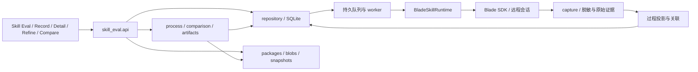
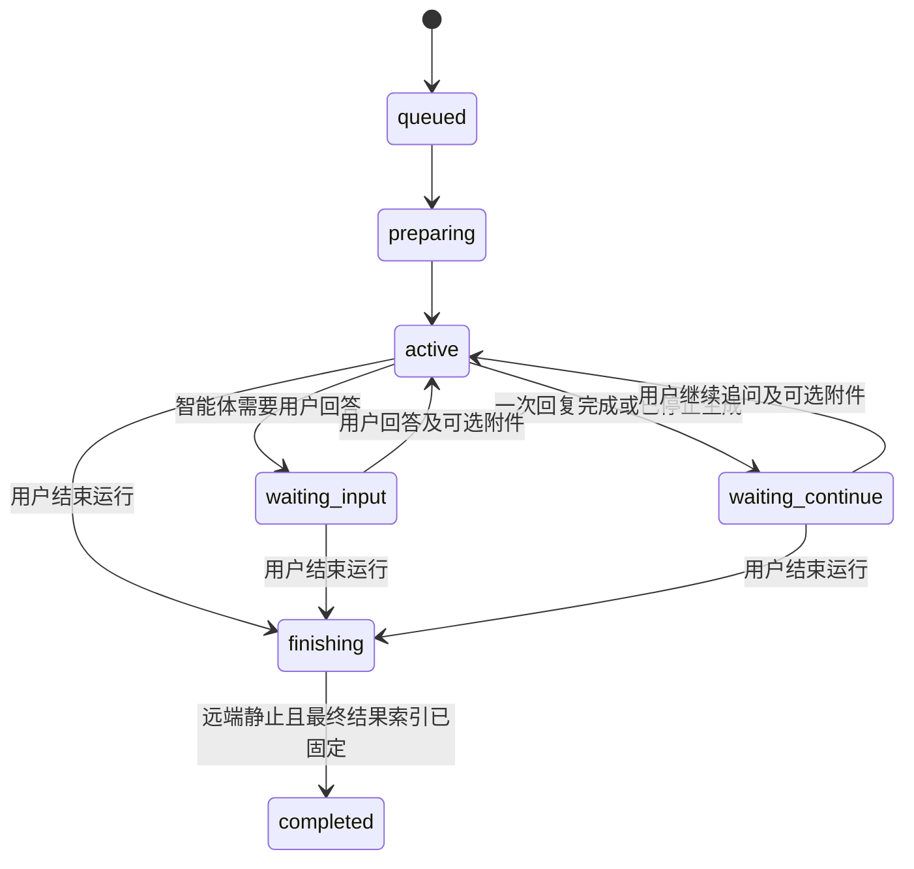

# Skill Eval 开发设计

版本：v0.5 · 2026-10-22 · 状态：已实施，真实主链通过；验收范围与限制见 acceptance.md

依据：[requirement.md](requirement.md) v1.1、[Pencil 设计](skill-eval.pen)及[页面预览](ui/index.html)。本文描述将要开发的方案；现有升级状态与历史协议调查保留在 [spec.md](spec.md)，后续开发以本文为技术设计入口。

逐步开发与测试验收见 [tasks.md](tasks.md)。任务状态独立记录，本文中的技术设计不表示实现已完成。

## 1. 设计结论与边界

在现有 FastAPI + SQLite + React 应用中新增独立的 Skill Eval 模块，提供 skill 工作副本、多文件编辑、不可变版本、执行、过程采集、历史、比较及可选运行备注。复用应用外壳、Blade SDK、采集策略、脱敏和产物预览，不将一次 skill 实验伪装成带评分的场景任务。

第一阶段智能体固定为 `blade-agent`，前后端均校验；一个运行只使用一个 skill、一个模型。新模块优先通过 SDK 上传、执行和观测，现有场景默认 CLI 通道保持原配置。CLI 与 SDK 均维持本次已升级版本，不要求新功能为使用 CLI 而增加双通道竞态。

以下区分贯穿接口和页面：

- **Skill 身份**：用户导入的一份 skill，同一管理范围内名称唯一，同名新增版本归于同一身份并汇总历史。
- **工作副本**：可以继续编辑的文件集合，具有修订号；基于不同运行微调时可建立多个副本。
- **用户版本**：同一 skill 内版本号唯一；未发布版本可反复保存，正式版本发布后不可变。版本号不强制 beta 后缀。
- **版本快照**：完整文件清单及内容的不可变版本，运行和导出均引用确定快照。
- **实验**：用户命名的测试目标，固定绑定一个 skill，收拢多次运行；一个 skill 可以有多个实验。
- **运行**：实验中的一次会话，固定 skill 快照，允许多轮回答、追问和附件；用户主动结束后固定最终结果，备注绑定整个运行。
- **生成／交互轮次**：运行内部的模型活动和用户输入，用于回看过程，不是独立实验结果或产物版本。
- **执行状态／采集状态／产物回收状态**：分别记录，任一项失败不覆盖其他项的事实。

纳入平台内版本发布：发布使用新版本号另建正式版，并保留来源未发布版本。不接入评分、裁判、自动优化、批量组合执行或外部 skill 市场发布。已确认产品决策见 requirement 第 11 节；剩余技术选择和限额见本文第 13 节。

## 2. 项目现状与复用方式

| 现有模块 | 已有能力及限制 | 本次处理 |
| --- | --- | --- |
| `backend/main.py`、`backend/api.py` | FastAPI 生命周期、API 注册、模型目录、SSE、现有运行与产物接口 | 注册独立 router、恢复及 worker；复用模型目录服务，避免复制现有大文件 |
| `backend/db.py` | SQLite/WAL，已有 tasks/runs/attempts、事件、评分与恢复数据 | 新增带 `skill_eval_` 前缀的业务表，使用同一 DB，新增幂等迁移入口 |
| `backend/run_dispatch.py`、`backend/adapters/base.py` | 面向 env/task/attempt 的执行输入，包含场景与评分约定 | 不直接调用其主调度；提取确有必要的 Blade 协议公共组件 |
| `backend/adapters/blade_service.py` | SDK 会话、事件、历史、文件和清理逻辑，但混有场景 skill、回调、自动回答约定 | 复用或提取协议层；不直接把现有自动回答话术用于 Skill Eval |
| `backend/adapters/blade_cli.py` | CLI 执行，事后通过 SDK 回收历史；未提供完整实时 stdout | 保持现有场景兼容，不作为新功能实时事件源 |
| `backend/wire/normalizers/blade.py` | socket/history 消息解析、调用 ID、执行单元关联、轨迹投影 | 提取可独立调用的解析与关联函数；继续回归现有 normalizer |
| `backend/wire/policy.py`、`redaction.py` | off/metadata/parsed/full，默认 metadata；部署上限与来源能力取交集 | 新模块复用同一规则，不能以 SDK 原始日志旁路采集限制 |
| `backend/wire/api.py`、`paths.py` | 查询与路径绑定现有 run/attempt，存储布局绑定 attempts | 不直接复用现有 URL 或伪造 attempt 行；增加 Skill Eval 自己的证据解析和权限入口 |
| `backend/input_snapshots.py` | 内容散列、原子写入，但引用 attempt 和场景 context | 复用散列／原子写入思路，新增适合多文件包的 manifest |
| `backend/artifact_preview.py`、`web/src/artifacts/` | 文件分类、Office 预览、受限 HTML 展示 | 提取可传入受校验文件描述符的组件，复用渲染器，不复用 attempt 专属查询 |
| `web/src/main.tsx`、`AppShell.tsx`、`styles.css` | React Router、导航、双语和现有视觉系统 | 新增两个导航入口和独立路由；沿用深色、绿主色和直角面板 |
| `backend/display_only.py` | 只读部署阻止写请求，启动跳过执行后台工作 | 新模块写接口、恢复器和 worker 同样受此开关限制 |

基线为 SDK `blade-agent-kit==2612.0.0b41`、CLI `2612.0.0-beta.41`（提交 `8690d275ddb1e2a760559b10aaf841ba3ca881b2`）。部署目标为用户指定预览服务，地址从配置读取。现有 SDK 协议测试已覆盖创建会话、上传正文／二进制 skill、历史与事件基本形状；尚未完成真实预览环境的上传执行、权限保留及实时闭环验收。

## 3. 模块与依赖



建议新增 `backend/skill_eval/`：

| 文件 | 职责 |
| --- | --- |
| `api.py`、`models.py` | API、请求响应校验与错误格式 |
| `schema.py`、`repository.py` | 表与迁移、事务、分页、修订号与幂等 |
| `packages.py`、`storage.py` | 导入校验、文件 manifest、blob、原子写入、版本保存／发布和 ZIP 导出 |
| `service.py` | 实验管理、版本保存／发布、临时快照、创建运行、交互与主动结束等事务 |
| `runtime.py` | BladeSkillRuntime，负责会话、skill／物料上传、chat、stop、历史和远端回执 |
| `worker.py`、`recovery.py` | 持久任务领取、租约、阶段推进、启动恢复和清理 |
| `capture.py`、`process.py` | 采集策略执行、事件去重、轮次／react 投影、缺口与重放 |
| `artifacts.py`、`comparison.py` | 产物索引及回收、快照差异和多次比较 |

不引入外部队列、独立数据库或新前端框架。首期采用单执行 worker 进程，允许其内部受控并发；数据库租约防止重复领取，不宣称仅凭租约即可保证远端调用 exactly-once。

## 4. 数据模型与文件存储

### 4.1 业务表

所有时间使用 UTC，API 返回 ISO 8601。ID 由服务端生成；逻辑外键必须验证，DB 开启外键约束并使用参数化 SQL。以下是新增表的主要字段，实施时转换为实际 DDL 与迁移测试。

| 表 | 主要字段与约束 |
| --- | --- |
| `skill_eval_skills` | `id, scope_id, name, name_key, source_kind(upload/catalog), source_ref, created_at, updated_at`；`UNIQUE(scope_id,name_key)`，身份不依赖路径 |
| `skill_eval_releases` | `id, skill_id, version_label, version_key, status(unpublished/published), current_version_id, revision, source_release_id?, published_at?, source_ref?, created_at, updated_at`；`UNIQUE(skill_id,version_key)`；未发布可更新内容指针，正式版不可更新 |
| `skill_eval_experiments` | `id, skill_id, name, created_at, updated_at`；固定 skill 外键，名称不作为身份；与平台旧 experiments 表分离 |
| `skill_eval_imports` | `id, scope_id, staging_ref, detected_name, detected_version?, state, expires_at, committed_release_id?`；待确认上传独立暂存，提交幂等，不产生半成功的 skill |
| `skill_eval_drafts` | `id, skill_id, source_run_id?, base_version_id?, source_release_id?, manifest_hash, revision, created_at, updated_at`；revision 用于乐观锁 |
| `skill_eval_versions` | `id, skill_id, content_hash, manifest_ref, created_at`；`UNIQUE(skill_id, content_hash)`，快照不可变 |
| `skill_eval_blobs` | `hash PK, size, storage_ref, created_at`；只记录已完整落盘并校验的内容 |
| `skill_eval_inputs` | `id, hash, original_name, media_type, size, created_at`；物料与 skill 文件独立身份，不复用外部原路径 |
| `skill_eval_runs` | `id, experiment_id, skill_id, draft_id, skill_version_id, source_release_id?, source_release_label?, source_release_revision?, source_run_id?, input_snapshot_json, input_hash, agent, requested_provider, requested_model, resolved_provider?, resolved_model?, model_resolution_source?, group_key, run_status, generation_status, capture_status, artifact_status, revision, finish_requested_at?, finalized_result_ref?, heartbeat_at?, created_at, started_at?, ended_at?, error_code?, error_message?, external_refs_json` |
| `skill_eval_messages` | `id, run_id, seq, kind(initial/followup/answer/context_reuse), text, attachment_refs_json, interaction_id?, source_message_refs_json, delivery_state, remote_receipt_json, created_at`；按 run 排序追加，不覆盖初始输入 |
| `skill_eval_interactions` | `id, run_id, remote_tool_call_id?, question_json, state(pending/answering/answered/closed), revision, answer_message_id?, created_at`；旧问题不能重复回答 |
| `skill_eval_generations` | `id, run_id, index, triggering_message_id, chat_run_id?, status, started_at, ended_at?, error?`；区分同一会话内多次 chat、暂停应答，不创建轮次产物快照 |
| `skill_eval_rerun_plans` | `id, source_run_id, through_user_seq, mode(reuse_all/replace), state(pending/confirmed), confirmed_at?, confirmed_message_refs_json, confirmed_input_refs_json, hash, expires_at`；手动确认重跑输入，来源新增输入后需重新确认 |
| `skill_eval_notes` | `run_id PK, text DEFAULT '', revision, updated_at`；运行创建时可不建行，读取默认空文本，保存清空等价于 text='' |
| `skill_eval_jobs` | `id, run_id, operation_id UNIQUE, phase, state, owner?, lease_until?, retry_count, next_retry_at?, last_error?`；prepare/message/finish/collect 独立持久任务，每个 run 同时最多一个远端写操作 |
| `skill_eval_requests` | `scope, operation, idempotency_key, request_hash, resource_id, created_at`；`UNIQUE(scope, operation, idempotency_key)` |
| `skill_eval_events` | `run_id, seq, event_id, source, source_key?, type, payload_json, raw_ref?, occurred_at?, observed_at`；`PRIMARY KEY(run_id, seq)`、`UNIQUE(run_id,event_id)`，source_key 存在时做来源去重 |
| `skill_eval_artifacts` | `id, run_id, relative_path, hash?, size?, media_type, state, error?, provenance_json`；`UNIQUE(run_id,relative_path)`，只索引最终文件，保留下载失败的索引项 |

索引至少包括 runs 的 `(skill_id,created_at,id)`、`(experiment_id,created_at,id)`、`(group_key,created_at,id)`、`(run_status,created_at,id)`，以及 jobs 的 `(state,next_retry_at,lease_until)`。历史列表使用 `(created_at,id)` 游标；分组分页固定查询时间边界，并以最新运行时间及 group_key 稳定排序。

experiment_id 与 skill_id 必须一致，服务端验证并以组合外键／事务约束防止错配；运行创建后不迁移所属 skill。运行的版本标签与 release revision 单独冻结，后续保存未发布版本不能让旧运行的展示内容漂移。

`input_snapshot_json` 冻结：skill_version_id、用户提示、系统启动指令（如有）、物料 ID／hash／远端相对路径、请求模型、会话模式、采集 requested/effective 及降档原因、超时和执行选项。运行中观察到的实际配置、版本、session_id、chat_run_id、上传回执进入独立的 `external_refs_json`，不得回写冻结输入。后续用户消息与附件写 messages；最终结果引用初始快照及截止消息 seq，既可查看初始输入，也可复盘完整交互。

requested 与 resolved 分开保存：确认实际模型后按 `agent + provider + canonical_model_id` 分组；未获取实际身份时使用标明 `requested/unverified` 的独立分组键，不与已确认身份静默合并。返回详情同时展示请求与实际差异，不从显示别名猜模型等价关系。

### 4.2 存储布局

```text
<data_path>/skill-eval/
  blobs/sha256/<前两位>/<hash>          # Skill、物料和最终产物的不可变字节
  manifests/<hash>.json               # 排序后的完整包清单
  previews/<hash>/<basename>          # 校验后物化的只读预览来源
  previews/<hash>/rendered/           # 既有受限 Office 渲染缓存
  .store.lock                        # 原子发布/DB 引用/无引用对象清理共用锁
```

实施决定：初始输入、消息、来源事件、阶段回执及最终结果索引直接保存在同一 SQLite 的 `skill_eval_*` 表中，来源正文先经过 policy/redaction 才作为事件 JSON 入库。不再重复写 JSONL 或 raw 镜像，因此不存在文件段与 DB 双写的一致性窗口。`skill_eval_result_collections` 保留明确补收的索引修订，比较表冻结选定修订；它不是对话轮次产物版本。过程从已提交来源事件确定性重建。


Manifest 每项包含稳定 file_id、相对 POSIX 路径、blob hash、size、text/binary、encoding 和 mode（规范化为 0644／0755，保留可执行位）。内容 hash 对路径排序后的路径、字节 hash、mode、encoding 计算，不包含 file_id、导入时间和显示名；不同导入生成的 file_id 不影响内容去重。file_id 支持同一工作副本内识别重命名；跨独立导入不强行猜重命名。

先写临时 blob、校验并原子 rename，再在 DB 事务中更新引用。DB 提交失败最多留下无引用 blob；不能出现已提交记录引用半文件。不可变 blob 不与可编辑文件共享可写硬链接。派生目录属于缓存，原始证据与快照才是重建依据；没有原始正文的旧数据不能重建出正文。

首期不提供自动清除历史；staging 与无引用 blob 延迟清理，清理前检查所有版本、草稿、物料、运行和产物引用，并避开正在提交的对象。后续保留期限生效时同步删除证据 blob，详情必须显示已过期，不能返回伪空结果。

## 5. Skill 导入、多文件编辑与导出

### 5.1 导入与已有 skill

上传使用 multipart，在解析前和逐块读取时分别执行请求体/文件上限；校验通过后创建有期限的待确认 import，字节进入内容寻址存储。单个 `SKILL.md` 建立根包；ZIP 仅接受根 `SKILL.md` 或唯一外层目录下的一个可确定根。多个候选根、无正文、非法 UTF-8、路径冲突时返回具体条目及错误。`__MACOSX` 等是否忽略由明确规则处理，不静默丢弃可能有用的 skill 资源。

拒绝绝对路径、`..`、符号链接、设备文件及规范化后重复路径；同时检查压缩字节数、解压总量、单条目、文件数量与压缩比例。保存脚本执行位，不保留 setuid 等特殊权限。正文 frontmatter 解析与 Blade 名称约束分开校验；远端执行时使用受控唯一名称，保留原文并记录映射，不因名称碰撞覆盖服务器已有 skill。

已有 skill 来源经 `SkillCatalog` 接口读取，来源为部署配置 `skill_eval.catalog_roots` 指定的服务器只读目录下的可识别包；只读导入为新工作副本，返回 catalog ID 和内容指纹，不向客户端暴露宿主机绝对路径。此来源方案已由用户确认；未配置时返回未配置状态，不扫描用户任意本机目录。

### 5.2 名称与用户版本冲突

名称在部署现有管理作用域内唯一；尚无用户作用域的部署使用固定 deployment scope，不能按每次上传生成新 scope 规避冲突。名称和版本键建议采用 Unicode NFC 与首尾空白清理，大小写保持区分，确认页展示规范化结果；空版本、内部保留键不可作为用户填写的版本号。版本标签首期不强制 SemVer，按字符串唯一性校验，不自动推断大小顺序。

导入先创建 pending import，只校验和暂存文件，不立即创建可使用的 skill。解析包的名称与版本元数据作为建议值：版本读取 `SKILL.md` 的 `metadata.version`，兼容顶层 `version`；两者不一致时要求明确选择，不静默覆盖。确认表单可填写名称与版本，显示包内原值；最终元数据留在平台导入记录，不暗中改写 SKILL.md 字节。

| 已有状态 | 上传／确认值 | 处理 |
| --- | --- | --- |
| 名称尚未使用 | 有版本号 | 沿用确认的版本号，创建未发布 release、初始快照及工作副本 |
| 名称尚未使用 | 无版本号 | 使用初始版本号 0.0.1，创建未发布 release；确认页展示默认值 |
| 名称已存在 | 无版本号 | 返回冲突，要求改为未使用名称，或填写该 skill 未使用的版本号 |
| 名称已存在 | 版本号已存在 | 返回冲突，不覆盖；即使内容相同仍需改名或换版本号 |
| 名称已存在 | 版本号尚不存在 | 确认归属后新增该 skill 的未发布 release，建立独立工作副本，保留全部旧记录 |

UI 冲突面板保留 upload_id，显示名称、已用版本、名称／版本编辑项和“确认导入”；错误信息定位字段。暂存过期才要求重传。前端预检仅用于提示，最终提交在同一 DB 事务中依靠 name_key 和 version_key 唯一约束完成检查与写入，两个浏览器并发提交相同版本只能一个成功，另一个返回 409 并保留暂存内容。

用户版本 `release` 与内容快照 `version` 分表：不同标签可引用同一不可变快照；未发布版本保存时使用 expected_release_revision 更新 current_version_id，原号可保存多次。页面展示版本号、未发布／已发布、未保存修改；运行冻结实际 snapshot，而非执行时再解析可变 release 指针。

发布请求必须带未使用的新版本号、期望草稿修订与来源版本修订；冻结确认的当前完整内容后，在事务中新增 published release，保留来源，不把原 release 改名或切状态。发布目标号与任何已有版本（含 beta）冲突均 409。发布没有上传外部库或启动执行的副作用。

正式版不可保存覆盖，从它派生的草稿 source_release_id 只表示来源，保存目标为空。允许先试跑；首次保存提交新版本号创建 unpublished release，之后同号保存。即使来源版本内容相同，上传同名同版本也始终冲突，不提供“覆盖 beta”入口。

导出 ZIP 保留原文件字节与执行位，以 ZIP comment 的命名空间 `octagon.skill` 保存名称、用户版本、发布状态、来源与内容指纹；导入时验证指纹，仅将这些值作为确认表单建议，不能绕过冲突校验。导出记录只提供导入建议，不将外部包直接认定为平台正式版；已修改内容导出注明来源用户版本及 modified 状态，重新导入同名时必须给出新版本或改名，不冒充已登记版本。普通 ZIP 或单 SKILL.md 没有平台元数据也能导入。

### 5.3 编辑与原子保存

前端为每个打开文件维护 `savedContent/currentBuffer/dirty`，目录变更与二进制上传也在待提交清单中。暂存 API 接受整个 change set 和 `expected_revision`，在一次事务中应用新增、修改、重命名、mode 变更和删除；先校验最终树，至少保留有效 SKILL.md，再 revision+1。任意一项失败整批不生效。暂存只更新编辑草稿，不更新 release；UI“保存版本”才原子更新未发布 release 的完整内容与修订号。

二进制替换先完成独立上传，change set 仅引用校验完成的 blob。服务端校验上传引用属于允许的作用域，不能根据客户端提交任意 hash 读取其他文件。文本默认 UTF-8；可识别的其他编码须保留 encoding 并在保存时验证可编码性，不确定时按二进制处理并允许替换，不能用替换字符静默损坏原文件。

保存冲突返回 `409 draft_revision_conflict` 和当前 revision；前端保留所有缓冲，可看差异后重试，不自动最后写入覆盖。基于历史运行微调采用新 draft，携带 source_run_id，不覆盖当前其他副本。

### 5.4 暂存、保存版本、发布、试跑与导出

| 操作 | 事务效果 |
| --- | --- |
| 暂存编辑草稿 | 持久化全部缓冲及目录变化，仅 draft revision+1；不更新用户版本，不显示“版本已保存” |
| 保存版本 | 整批校验并冻结内容；更新期望 revision 的未发布 release；目标缺失时要求新版本号并创建未发布 release；正式版拒绝覆盖 |
| 试跑／重跑 | 发送完整 changeset 或先暂存草稿，再冻结指定 revision；只创建 snapshot/run，不更新 release、不要求新版本号 |
| 发布正式版 | 冻结确认内容，使用新版本号新增 immutable published release，保留原版本 |
| 导出当前内容 | 冻结包括未保存缓冲的整包并生成 ZIP，不更新用户版本或创建运行 |
| 导出本次 skill | 只按运行 skill_version_id 读取，不解析当前 draft/release 指针 |

暂存与正式保存在 UI、API 和响应中明确区分：网络传输使当前编辑持久化不等于用户点击保存版本。快照接口接受 expected_revision 与整批 changeset，原子校验并生成 snapshot_id；运行／导出直接使用返回 ID，期间其他标签的编辑不改变已确认内容。冻结失败保留所有编辑缓冲。

ZIP 只包含包文件，设置执行位并保留目录；排除提示、物料、备注、日志与产物。相同 snapshot_id 可用于多次运行；新 run 总是独立身份。原子保存未发布版本产生新快照，旧运行引用保持不变。

## 6. 执行、停止与恢复

### 6.1 会话生命周期与生成状态

整次运行状态 `run_status` 与当前生成状态分开，不能把 SDK 一次 chat:end 映射为整次运行 completed。



queued/preparing 的取消可进入 cancelled；不可恢复的错误可进入 failed，保留可得结果；最终状态不可继续追加消息。正常轮次完成仅进入 waiting_continue。已确认中断的生成仍可继续；投递/会话身份不确定或生成异常进入 failed 并保留部分证据，不自动重发。可显式停止核查/仅重试回收，或手动确认输入后新建运行。

`generation_status`：`idle / queued / running / paused / stopping / stopped / completed / failed`，每个 generation 保存 chat_run_id，状态不覆盖运行归属。`stop-generation` 只停止当前实际生成，确认后运行进入 waiting_continue；`finish` 原子关闭消息入口，存在活动生成时执行真实 stop，再等待静止和最终产物回收。

`stage` 包含会话准备、上传、生成、交互等待、停止确认、最终回收与对账。`capture_status` 为 pending/live/reconnecting/finalizing/complete/partial/failed/disabled；complete 仅表示生效范围无已知缺口。`artifact_status` 为 pending/collecting/complete/partial/failed。回收失败可固定“最终结果不完整”的索引并允许仅重试回收，不重新执行模型。

等待用户输入或继续时释放生成并发额度，持久化会话身份；后续消息重新领取生成任务。等待时间不计入单次生成超时；空闲会话保留与资源回收限额另行配置并显式显示，会话失效时不能偷偷新建会话冒充继续。

final-result 不依赖文件存在：`artifacts=[]` 可以是正常的文字结果。首期仅评测读取输入、生成文字结论或新输出文件；不实现通用 `effects[]`／`input_changes[]` 业务结果模型或外部状态核验／回滚系统。HTTP 查询可用；以外部写入或原地修改／删除上传物料为目标的 skill 不在支持范围。已有过程事件仍保存真实行动与返回；观察到此类行为时展示超出评测范围的说明，不生成“外部效果已验证”结论、不为核验重发操作。原始上传 blob 不变。空目录已成功检查才显示无文件产物；列表／下载失败记录 unknown/partial。

final-result 包含 run_id、固定的 skill_snapshot_id、截止用户消息 seq、最终回复引用、可观察操作／影响的证据引用、产物清单及完整性说明。最终文件只在结束时固定，不为各对话轮次建立产物快照；若回收失败后补收，记录回收 generation 并让比较页固定本次读取的最终结果索引，后续补收须显式刷新。

结束后只固化最终结果和产物，不建立轮次产物版本；消息与过程仍可按轮次浏览。finish 与消息提交通过 run revision、finish_requested_at 和每会话串行锁互斥，先提交 finish 后提交的消息返回 run_finishing；最后一条已接受消息及实际停止边界记录在 final-result 中。

### 6.2 提交与执行顺序

1. 创建运行接口检查实验归属、功能开关、blade-agent、模型、snapshot_id、上传完成、配额、采集设置；重跑还需已确认 rerun_plan_id，冻结初始输入。在同一短事务中插入 queued run、job 和幂等映射，立即返回 202；远端调用在事务外进行。
2. worker 领取并续租任务，检查取消标记；创建独立远端会话，将 session_id 持久化后再上传。会话创建参数及是否自动启动必须先通过真实服务验证，不能假设 `intent` 只是显示标签。
3. SDK `upload_session_skill(session_id, name, files)` 上传冻结包，文本原字节按协议编码、二进制 base64；记录回执。通过 `upload_file(...,dir_path,remote_path)` 上传物料到 `inputs/`，原文件名与远端映射保存于输入快照。
4. 确认会话配置、模型和 skill 发现／激活方式。必要启动上下文与用户提示分开留存，不静默改写 SKILL.md；上传成功只标记已上传，读取／调用证据另记。
5. 建立持久采集器后调用 SDK `chat`，持续消费事件；同一 chat 流已提供全部所需事件时不再重复订阅。若需 `subscribe`，必须确认订阅就绪后发送，重复来源统一去重。
6. 一次 chat 结束后读取历史并对账，进入 waiting_input 或 waiting_continue，释放生成任务但保留会话；后续消息仍走同一 session。用户 finish 后才停止未结束执行，回收结束时的最终结果与产物，固定 final-result、coverage 和 ended_at。

`BladeSkillRuntime` 提供 `prepare/start/observe/send_message/answer_interaction/stop_generation/finish/recover_history/collect_artifacts` 内部协议，传递不可变 `SkillEvalRunInput`，不含 env_token、scorer 或本机回调 URL。SDK 缺失、鉴权失败或模型不可用时明确报错，不静默回落其他智能体或 CLI。

beta.41 SDK 的 skill 文件上传使用 executable 布尔值保留执行位，二进制使用 base64。已对 beta.42/43/44 服务验证脚本直接执行及二进制输出字节。skill_dir 回执可能是宿主机路径，不传给沙箱模型；使用 refs 激活内部命名的技能，源文件字节不改写。

### 6.3 幂等与崩溃恢复

创建运行要求 `Idempotency-Key`，其作用域包含接口、skill 和当前部署访问域。同 key 同请求返回原 run；同 key 不同请求返回 409。用户主动再次运行生成新 key；传输重试保留原 key。

worker 每个远端副作用前后写 phase 与回执。服务重启只领取租约过期任务；已绑定 session 的运行重新订阅或读取历史，绝不重新发送原提示。若尚未开始 chat，可依据已确认上传回执继续准备。

创建会话或发送 chat 超时且服务端是否接受未知时，标记 `remote_acceptance_unknown` 并进入核查，不盲目重试。优先使用服务支持的请求幂等键或可查询关联标识；若 beta.41 不支持，保留可能的孤儿会话／执行信息，提示无法确认，宁可结束为不确定失败，也不制造重复执行。SDK/API 自动重试也必须检查是否会重复发送写操作。

停止生成／结束运行均先持久记录操作，再调用 SDK `stop(session_id,chat_run_id=...)`；停止确认失败时重试并显示确认中，不提前将整次运行标 cancelled。已终态 finish 幂等返回最终索引。服务重启根据 run 状态恢复等待、应答或 finish，不因用户关闭页面擅自结束，也不自动填写旧场景回答。

### 6.4 用户消息、附件与智能体提问

同一 session 内串行提交消息，API 接受 Idempotency-Key、文字与 input_ids；问题应答另可传 expected_revision 校验问题修订。先持久化消息及投递任务，再上传本条附件、保存映射回执，最后发送消息；正文与附件可同时提供。附件失败保留待发送消息，不能先发文字再漏掉本条附件。初次启动可仅有 skill；无文本时按经验证的 Blade 启动契约发送可见的单独系统启动指令。

智能体提问保存 interaction_id、问题原文、真实 tool_call_id 和待答状态。已有 Blade adapter 通过 SDK chat 的 askuser_answer 携带结构化应答，说明不能把所有回答当作普通自由消息；新 runtime 复用其字段构造但由用户实际回答。核验新 runtime 的 headless／交互配置不会将提问误判为 unexpected_interaction 或自动代答，确认 beta.41 的暂停／应答字段及附件就绪顺序后，再接正式发送，不能沿用 benchmark 的自动代答逻辑。一般后续追问使用普通 chat，并保留本次 session。

同一 interaction 只接受一次已确认回答；旧问题／并发回答返回明确冲突。投递超时进入 acceptance_unknown，依据远端 message/chat_run_id 对账，不盲目重发。附件用稳定 input_id 与每条投递的路径映射，同名追加不能静默覆盖上条已上传输入。所有用户输入与附件都进入本次运行的追加日志，平台备注不作为对话输入。

### 6.5 重跑输入确认

重跑先创建确认计划：用户手动选择 reuse_all 或 replace。reuse_all 收集来源运行截至 through_user_seq 的初始提示、全部回答／追问和用户上传附件，确认页面完整展示；replace 清空旧输入，用户可重新填写／上传或全部留空。不得自动选定某种方式并直接运行。

plan 记录来源用户消息 ID、附件 hash、截止 seq、确认输入及 hash。提交新 run 时再次验证计划、实验 skill 及附件权限；若来源新增用户消息或附件，要求重新确认。新会话不继承旧模型回复、生成产物或工具返回；问题关联只作为已确认用户答案的来源说明，不发送旧工具调用 ID 作为本会话交互应答。

所有用户消息及附件内容必须带全，但不能在新会话里机械回放旧消息、触发多次副作用。建议初始请求以有序“用户输入上下文”携带，保留原始条目与路径映射，单独记录提交给模型的实际表达；其具体协议在 D0 验证。超限时报告并要求用户改选重新提供，不静默截断、摘要或丢附件。

## 7. 过程采集与“思考 → 行动 → 返回 → react”

### 7.1 来源证据与可重建投影

采集分为来源事实、规范化过程事件、页面轮次投影三层。落盘前执行有效采集策略与脱敏；metadata 档不写正文到 raw 文件或调试日志。新模块请求 parsed 时不能额外套用隐式 metadata 的场景默认值将其意外压低；只有实际部署限制、明确请求和来源能力参与交集，保持现有 policy 函数本身语义不变。对外所谓原始事件是策略允许的来源原文，同时标明字段已脱敏、截断、未采集或未提供。服务端 API key、Authorization 等不进入导出或浏览器响应。

SDK `RawEvent` 已知有 `raw.type/payload/stream_sequence`；history 带 node/message/tool_call_id。接入时保存真实字段，不假设所有来源都有模型调用 ID、完整 request context 或单调序号。已有 normalizer 包含旧 history 的 FIFO 推断与跨来源正文对消；新流程不直接把这些推断当确认因果。提取解析函数时将明确关联、推断关联和无法确认分别输出。

过程事件字段建议：

```text
id, run_id, seq, source, source_session_id, source_event_id?, source_sequence?,
kind, observed_at, occurred_at?, agent_id, loop_id?, model_call_id?,
message_id?, tool_call_id?, parent_event_ids[], raw_ref,
content_ref?, visibility, capture_state, correlation_confidence, revision
```

kind 至少覆盖 user_message、user_attachment、interaction_request、interaction_answer、run_finished、model_message、public_reasoning、reasoning_summary、tool_call、tool_return、run_state、context、capture_gap；增量文本以 delta 事件追加，终态投影生成完整消息。来源记录 ID 保持不变，流片段不是多个独立调用。API 未提供字段保持 null，并附缺口原因。

### 7.2 去重与实时恢复

- 同来源优先 `(session_id,source_event_id)` 或服务保证范围内的 `(session_id,stream_sequence)`；若重连序号会重置，必须加真实 stream 实例标识。
- socket 与 history 根据明确 message/tool_call ID 合并字段与 provenance；同一消息新补全正文用 revision 更新投影，不覆盖来源证据。
- 不能只用正文 hash 全局去重；模型可能合法地重复同一句话。无可靠跨源 ID 时保留未确认重复并标记，不删真实事件。
- 来源事实、run-local seq 和来源去重键在 SQLite 同一事务提交；通知在提交后发送，失败可从 DB 游标补读。SSE 不内嵌大正文，仅发布已提交的事件身份；证据按权限与策略读取。
- 浏览器断线用本地 seq 续读，浏览器重连不调用 chat。远端断流根据 SDK 能力重新订阅并拉历史；历史只能修复消息终态，无法补回的流片段、思考或上下文写 capture_gap。
- 过程分页冻结来源 head 与 schema version，使用 `projection_generation=schema:head`；游标包含 run、head、offset 和 search，新增事实不改变已开始分页。schema 不匹配返回 reset_required，不可用 head 返回 snapshot_required；SSE 超前游标发送 reset。

首期事件写入只追加新增事实，页面通过合并更新通知降低读取频率；process 按冻结 head 计算可重放投影并分页响应，前端连续补读。该计算开销随历史长度增长，后续可增加可重建缓存；当前不持久保存第二份过程正文。旧 BladeNormalizer 保持兼容，使用真实公开事件 fixture 校验新投影。

### 7.3 轮次与 react

一个模型调用关联公开思考／普通消息及其发起的多个工具调用；每个调用按同执行单元和真实 tool_call_id 配对返回，重试保留独立调用。下一模型回复对一个或多个返回的反应，使用事件引用展示在前轮末尾；它同时属于下一轮，但不复制事件或重复计数。

有实际上下文引用时建立明确因果；只有顺序证据时显示“后续模型回复，关联未确认”。不同 loop 的相邻时间不代表同一因果链。并行返回各自展开；模型收到哪些返回未知时不声称全部已读。没有自然语言 react、直接发起下一调用时展示真实下一行动。

页面提供轮次导航、原始时间顺序、搜索、展开参数／返回、模型实际上下文、原始证据及缺口。上下文入口只展示采集到的真实请求或服务提供的快照；从消息历史拼出的回放须标为“历史消息，非实际请求上下文”。首期不生成 AI 总结或补写私有推理。

状态条仅根据可观察事件展示模型生成、工具执行、等待输入等；无新事件展示最后事件时间。用户滚动上翻时暂停跟随，新增事件只更新计数。

## 8. API 契约

统一前缀 `/api/skill-eval`，以下均为拟新增接口，不是已有服务事实。错误沿用 FastAPI detail 并规范为 `{code,message,fields?,retryable?,request_id}`；列表默认 50、上限 200，正文与原始证据按需读取。所有资源引用必须验证所属 skill／run，文件入口只接受 ID，不接受宿主机任意路径。

| 方法与路径 | 输入／输出与职责 |
| --- | --- |
| `GET /capabilities` | 功能开关、Blade 服务／SDK／CLI 实际版本、可达／鉴权、上传／事件／历史／停止能力、采集上限与限制；unknown 与 unavailable 分开 |
| `GET /models`、`GET /catalog` | 复用目标 Blade 模型目录；catalog 列出可复制来源及指纹，不透出凭据和绝对路径 |
| `POST /skills/import` | multipart SKILL.md／ZIP；暂存并返回 import_id、识别名称／版本、冲突与建议，不直接完成导入 |
| `POST /imports/{id}/commit` | 确认 name、version?（目标 skill 由规范化名称确定）；事务校验唯一性并创建 release／快照／draft，返回所属 skill；同一 import 重试返回既有结果 |
| `GET /imports/{id}` | 恢复待确认内容、冲突与过期时间；仅所属作用域可访问 |
| `POST /skills/from-catalog` | catalog_id、期望指纹；复制为待确认 import，同样经过名称／版本校验，不修改来源 |
| `GET /skills`、`GET /skills/{id}` | 可访问 skill 列表；详情及可用副本，不内联全量正文 |
| `GET /experiments`、`POST /experiments` | 按 skill 查询／新建命名实验；创建后绑定 skill 不变 |
| `GET /experiments/{id}`、`PATCH /experiments/{id}` | 实验详情与改名，不允许更换 skill |
| `POST /drafts`、`POST /runs/{id}/drafts` | 分别按 release_id 或来源运行冻结快照派生独立工作副本 |
| `GET /drafts/{id}` | revision、manifest、来源、修改摘要 |
| `GET /drafts/{id}/files?path=...`、`GET /drafts/{id}/download?path=...` | 文本正文或二进制描述；支持下载／预览 |
| `PATCH /drafts/{id}` | expected_revision + changes[]；整批原子暂存编辑缓冲，返回新 revision，不更新 release |
| `POST /drafts/{id}/snapshots` | expected_revision + changes[]；冻结全部当前内容，返回 snapshot_id，不保存用户版本 |
| `POST /drafts/{id}/save` | expected_revision、expected_release_revision、changes[]、草稿既有保存目标或新 version；保存全部未发布版本内容 |
| `POST /drafts/{id}/publish` | expected_revision、changes[]、expected_release_revision、新 version；另建 immutable published release，保留原版本 |
| `POST /inputs` | multipart 任务物料；Skill 资源通过整包 changes 的 text/base64 写入，两个引用域独立 |
| `GET /inputs/{id}` | 物料信息、预览或下载 |
| `POST /drafts/{id}/export` | expected_revision + changes[]；返回全部当前内容的 ZIP，不自动保存用户版本 |
| `GET /versions/{id}/export`、`GET /releases/{id}/export` | 前者导出不可变快照；后者明确带所选版本号/状态/修订。`GET /runs/{id}/skill/export` 带历史冻结标签 |
| `POST /runs` | Idempotency-Key、experiment_id、snapshot_id、可选 prompt/input_ids、agent/model、capture_policy；重跑须携带 source_run_id、rerun_plan_id；返回 202 + run_id |
| `POST /rerun-plans` | source_run_id + 手动选择 reuse_all/replace，返回完整用户输入／附件清单、截止 seq 和待确认 hash |
| `POST /rerun-plans/{id}/confirm` | expected_hash、用户确认的全部输入／新输入；验证来源未变化后标记已确认，才允许提交新 run |
| `GET /runs` | experiment/skill/release/model/group/status/time 游标筛选，带备注摘要与来源关系 |
| `GET /record-groups` | 按 agent/provider/canonical model 归组及数量、最近运行／状态 |
| `GET /runs/{id}` | 冻结输入、实际配置、状态、结果概览、采集范围、备注、来源、产物摘要 |
| `POST /runs/{id}/messages` | 幂等追加追问，含text、input_ids；问题应答另带 expected_revision；沿用原 session |
| `POST /runs/{id}/interactions/{interaction_id}/answer` | 用户实际答案与附件，校验问题 revision 并走结构化应答，不自动代答 |
| `POST /runs/{id}/stop-generation` | 停止当前远端生成，保留可继续的 run；未开始的队列任务可取消 |
| `POST /runs/{id}/finish` | 幂等关闭消息入口，停止／等待活动生成并固定最终结果，不再接受追加 |
| `GET /runs/{id}/events`、`GET /runs/{id}/events/stream` | 前者 after + limit 分页；后者 Last-Event-ID 或 after 续读，发送已提交事件通知与 heartbeat。状态/备注等同时以只读轮询校准 |
| `GET /runs/{id}/process` | 固定来源 head 的模型回复分页、search、next_cursor、缺口；原始时间顺序由 events 分页提供 |
| `GET /runs/{id}/evidence/{event_id}` | 受相同采集权限约束的已采原文、上下文和来源，不提供策略禁止的字段 |
| `GET /runs/{id}/artifacts`、`GET /artifacts/{id}` | 产物列表、回收状态、预览／下载描述；预览未就绪可轮询 |
| `PUT /runs/{id}/note` | text、expected_revision；空字符串清空，409 保留客户端内容 |
| `POST /comparisons/query` | 已结束 run_ids（至少 2）、baseline_run_id；返回各列身份与最终结果引用、差异摘要与缺失项，不创建执行 |
| `GET /comparisons/{id}/diff` | left/right + kind=result/skill/artifact + 可选 path；按需返回受限差异。`GET /comparisons/{id}` 读取固定清单；/artifact 与 /artifact-preview 读取该清单固定的字节 |

导入、上传接口需要将 `python-multipart` 从仅 dev extra 调整为运行依赖。导出准备使用 POST，因此纯展示节点不创建新快照，但已存在历史版本仍可 GET 下载。

创建运行请求示例（字段是本模块契约，不直接透传 SDK）：

```json
{
  "experiment_id": "exp_01",
  "snapshot_id": "snapshot_08",
  "rerun_plan_id": "rerun_plan_01",
  "source_run_id": "serun_018",
  "agent": "blade-agent",
  "model": {"provider": "catalog-provider-id", "id": "catalog-model-id"},
  "prompt": "分析附件并生成报告",
  "input_ids": ["input_01"],
  "capture_policy": "full"
}
```

服务端从 catalog 验证 provider/model，客户端不能任意指定服务地址。成功返回 `{run_id,run_status:'queued',skill_version_id,detail_url}`；source_run_id 必须属于当前 skill，服务端验证其来源快照关系。派生草稿展示来源模型与输入，必须经过重跑确认计划；用户显式提交整份配置，不依赖服务端在执行时读取来源运行的可变状态。

备注为每次运行单段文本，建议上限 10,000 字符并可配置；不必在运行前填写。`GET run` 返回 `{text:'',revision:0}` 表示暂无备注；保存只更新该次备注，不更改冻结输入或模型上下文。未保存离开提示、失败保留缓冲、成功后刷新列表摘要；新 run 默认空备注。

SSE id 使用 run 局部已提交 seq；发送心跳不推进业务游标。通知只携带小型摘要，长正文按事件 ID 拉取。分页补读后再接实时流；不存在可用游标时返回 snapshot_required，而不是静默遗漏。对浏览器写操作重试与远端写操作重试采用不同策略。

## 9. 前端页面与状态

新增 `web/src/skillEval/`，分离 `api.ts/types.ts`、页面、编辑状态与过程组件；在 `main.tsx`、AppShell、面包屑和 i18n 注册入口。沿用现有 fetch 与 React hooks 模式，不为本功能引入全局状态框架。

| 路由 | 页面结构与行为 |
| --- | --- |
| `/skill-eval` | 上传确认／重名处理面板；空态或恢复上次选定 skill；无数据时上传／选择入口可用 |
| `/skill-eval/skills/:skillId?draft=:draftId&experiment=:experimentId` | 实验选择／新建／改名，右上 skill 与版本状态，右下跨实验历史及筛选；运行绑定所选实验 |
| `/skill-eval/runs/:runId?view=result`（支持切换 process） | 多轮聊天及附件、问题应答、停止生成、结束运行；结束后只读最终结果／产物、流程、全部用户输入、备注及冻结 skill 导出 |
| `/skill-eval/runs/:runId/refine?draft=:draftId` | 左来源结果／流程／备注只读，右多文件编辑器；保存未发布版本、发布新号正式版、全包差异、导出、重跑输入确认、不保存试跑 |
| `/skill-eval/compare?runs=...&baseline=...` | 2+ 列比较，横向浏览；窄屏基准／当前切换 |
| `/skill-eval-records` | 一级模型分组、二级运行，筛选与展开态可恢复 |

新增／切换实验必须核对 skill 归属；无实验时先要求用户创建或选择命名实验，不能把实验名称等同于 skill 名称。

微调入口创建新 draft 后 replace URL，刷新按 draft_id 恢复，不再重复创建。普通编辑与微调共用 SkillPackageEditor；来源结果、错误和备注是可切换证据，不是代码编辑器的一部分。调整输入采用必经确认面板，提供带上全部用户输入及附件／重新提供，不影响所有文件编辑缓冲。未发布版本保存与发布正式版分离；后者要求新版本号。运行中聊天和生成状态独立呈现，不把每轮回复完成写成“实验已完成”。

建议使用 CodeMirror 6 构建脚本／Markdown 编辑和只读差异视图，实施时锁定依赖；这是新增依赖而非仓库已有组件。标签未保存标记、目录变更清单和整体保存由上层状态控制。大文件与二进制不直接塞入编辑器。编辑器保留源码内容，不擅自格式化整个包。

URL 存筛选、分页游标、group、skill、experiment、release、运行选中 ID 与基准；sessionStorage 保存非敏感阅读位置和返回位置，不把大文件内容或密钥存到 URL。本地未保存缓冲通过站内导航阻拦与 beforeunload 提示保护；服务端已保存副本可跨刷新恢复。运行订阅仅在对应页面挂载，不因多列比较启动重复执行。

工作区运行配置处常驻显示首期适用范围，详情与比较提供说明入口；范围文案见 requirement 第 6 节。输入修改与外部写操作没有经验证的强制隔离时，不使用“已拦截”“无副作用”等字样。文字结论无需文件即可查看和比较。

比较只读终态 run 的 final-result 索引（失败／取消明确标部分结果），不提供 result_turn 或各轮产物选择；消息轮次仍可用于过程浏览。比较 API 分离摘要与重型 diff，每列按需加载结果、产物和流程。不能比较的运行保留缺失列说明；少于两次可访问记录时不展示成功比较态。事件序号只在各自运行内有意义，不按相同序号强行对齐。

## 10. 产物、配置与运行约束

远端执行目录与 Octagon 本地目录完全独立。上传前保存 inputs 基线清单与 hash，结束后通过 SDK `list_dir/download_file` 回收已确认输出；输入及 skill 源文件默认不作为产物，首期不将原地修改输入作为支持的结果类型。若发现变化，保留可观察证据并提示超出范围，不覆盖原件或自动转为正常输出；用户应让 skill 另存新输出文件。修改后的远端 skill 只能作为运行产生的文件证据，不能覆盖本地冻结版本或自动替换工作副本。

只回收结束时的最终文件；运行中为预览下载的文件可替换缓存，不登记为历史产物版本。最终回收必须在远端停止／静止后进行，下载期间文件变化则重新核验并标不一致，不能将混合时点宣称为确定快照。对于未受控后台任务或外部副作用只保留可观察证据与缺口，不承诺远端具有跨文件原子快照能力。

下载限制路径、符号链接、单文件、总量、数量及超时；允许记录因配额未下载的条目。下载字节写临时文件并校验完成后发布。产物 API 只通过索引 ID 寻址；Office／HTML 继续沿用现有预览隔离约束。停止或失败后尽力回收已有输出，失败单独显示并可重试回收，不重新执行模型任务。

建议新增配置 `skill_eval.enabled`、`catalog_roots`、`limits`、`max_active_runs`、`generation_timeout_seconds`、`idle_session_retention_seconds`、`lease_seconds`、`recovery_poll_seconds`。Blade URL 与鉴权继续使用现有配置，不在页面保存服务密钥。`enabled=false` 禁止新建执行但可保留已有历史只读；display_only 进一步阻止写入及后台任务。

建议初始可配置限额：skill 压缩包 20 MiB、解压后 100 MiB／1,000 文件、单文件 20 MiB，物料总量 100 MiB，文本编辑 1 MiB，单产物 50 MiB／总量 200 MiB，单次生成 600 秒、生成并发 2（等待用户时不占该额度）。最终值取本地配置与远端实际限制的较小者；这些数值尚待确认，预览和编辑上限必须分别展示，不能以编辑器限制误报包非法。

新增流程证据接口遵循现有部署访问边界；如部署有用户／工作区作用域，查询、上传引用、导出、SSE 与静态缓存必须沿用该作用域。首期不额外实现多人协作或评论权限体系。日志记录 run/session/request ID、阶段、耗时与失败原因，不输出密钥和正文。

## 11. 实施顺序与验证

| 阶段 | 交付 | 验证重点 |
| --- | --- | --- |
| D0 协议验证 | 固定 beta.41 的小型 skill／脚本／二进制附件样本和事件 fixture，记录真实版本及能力 | 新会话创建无意外启动、skill 激活、输入路径、执行位、指定模型、无提示无物料启动、真实问题应答、追问和追加附件、轮次结束不终结 run、事件首段、stop/finish、断流恢复；无凭据时不得宣称完成 |
| D1 数据与包 | 实验／版本表迁移、blob／manifest、导入、保存／发布、临时快照导出及接口 | ZIP 穿越／炸弹／重复路径、同名缺版本／重复版本／并发冲突、版本标签与快照分离、二进制与 mode 往返、原子保存、revision 冲突、正式版本不可覆盖、未发布版本可更新且旧运行快照不变、源目录删除仍可读 |
| D2 执行闭环 | 独立持久队列、SDK runtime、多轮消息／附件、输入确认、结束与最终回收、停止和恢复 | 提交／回答幂等、消息与结束竞态、等待不超时／不占生成额度、崩溃窗口、取消竞态、超时真停止、上传失败不启动、无评分／本机回调依赖 |
| D3 过程与实时 | 原始证据、增量投影、SSE、轮次、react、缺口与历史对账 | 并行返回反序、重试、同文不同消息、socket/history 重复、关联未确认、采集降档与脱敏不旁路 |
| D4 页面闭环 | 工作区、详情、基于结果微调、全局记录、可选备注、2+ 比较 | 版本保存／发布、不保存试跑、实验分组、重跑输入必确认、最终结果比较、不存轮次产物、URL恢复、空备注／清空／冲突、三列与多列、来源快照不变、双语／窄屏 |
| D5 集成验收 | 预览环境完整闭环记录、部署配置、运维与失败恢复说明 | requirement 全部验收、现有场景／CLI／wire 回归、只读部署不执行 |

建议使用 pytest + respx 验证 SDK 边界与故障，真实 fixture 验证过程投影；Vitest + Testing Library 验证页面状态与关键交互，最后做浏览器端端到端冒烟。不以模拟 HTTP 测试代替真实 Blade 验收。

验收映射：REQ-01→D4 导航与工作区；REQ-02/03/04→D1 包与资源；REQ-05→D2 幂等执行；REQ-06/07→D3 证据和 react；REQ-08→D2/D3 停止恢复；REQ-09→D4 详情；REQ-10→D1/D2/D4 微调重跑；REQ-11→D4 多次比较；REQ-12→D4 分组历史；REQ-13→D1/D4 备注和准确版本导出；REQ-14→D0/D5 指定环境真实联调；REQ-15→D2/D4 前后端 Blade 范围校验；REQ-16→D1/D4 全包多文件编辑与保存；REQ-17→D1/D4 来源证据、差异、重跑输入和未保存状态；REQ-18→D1/D4 重名版本确认、唯一约束与历史隔离；REQ-19→D1/D4 版本保存／发布及初始号；REQ-20→D1/D4 命名实验与跨实验比较；REQ-21→D0/D2/D4 无必填输入、多轮回答与附件；REQ-22→D2/D4 主动结束及最终结果；REQ-23→D1/D2/D4 正式版派生和未保存试跑。requirement 后续新增编号须同步补入映射。

执行链回归覆盖 `tests/test_blade_cli_adapter.py`、`tests/test_blade_sdk_compat.py` 及既有 wire、恢复、display_only 测试；前端执行测试与 `npm run build`，后端执行相应测试并扩展到全量。纯文档阶段不把这些测试视为已执行的功能验收。

## 12. 风险与落实要求

| 风险 | 必须落实的处理 |
| --- | --- |
| 测试版协议或服务更新 | 保存实际服务／SDK／CLI 版本和 parser 版本；能力 unknown 不写 available，关键协议不兼容时阻止新执行 |
| skill 上传成功却未被使用 | 分开展示上传回执、读取／调用证据；D0 验证发现与激活机制，不从最终结果猜使用成功 |
| 远端副作用与本地事务无法原子提交 | 阶段回执、请求关联、恢复核查；不确定窗口不自动重发 |
| 思考／上下文缺失 | 分字段 coverage 与原因；不把 history 当实际模型请求，不生成填补内容 |
| 现有 wire 链路绑定 attempt | 先抽可复用解析／渲染，独立寻址与归属校验；避免将新数据塞入旧评分表 |
| 多文件修改部分保存、导出错版本 | 整批事务、revision、不可变 manifest；导出与重跑都引用冻结结果 |
| 停止后产物／历史读取失败 | 执行与采集／回收状态分离，允许只重试回收，保留远端身份以便恢复 |

## 13. 已确认产品决策与剩余技术评审

已确认：同名归属同 skill；未发布同号保存、发布新号另建正式版且保留来源；上传重复版本始终拒绝；首次缺版本默认 0.0.1；未保存可试跑；实验绑定单 skill；新运行新会话、同一运行正常多轮交互；默认采集可获得正文；提示／附件可空；重跑需手动确认带全用户输入／附件或重新提供；用户主动结束、最终结果比较、不保存轮次产物；每次运行一个可选备注。

| 剩余项 | 实施建议／验证要求 |
| --- | --- |
| Blade 启动与交互协议 | D0 验证空提示启动、askuser_answer、普通追问、附件和 pause/resume、stop/finish 边界；不修改已确认交互范围 |
| 正文采集档位 | 显式请求至少满足公开思考／参数／返回正文的来源档位；parsed/full 按真实 fixture 验证，部署限制须提前显示 |
| 重跑上下文表达 | 新会话有序携带所有确认用户输入与附件，不包含旧模型结果，不机械执行历史指令；保留实际提交表达及来源 |
| 额外执行参数 | 结果／流程是视图；是否暴露 planning／executing 等服务选项另行评审，不把多轮交互当可关闭的执行模式 |
| 已有 skill catalog（已确认） | 部署配置服务器只读目录，复制导入；禁止写回和客户端任意路径 |
| 容量与会话资源 | 包／文件限制、生成超时、生成并发、空闲会话保留、最终回收与后台任务静止确认，均需配置与远端能力验证 |
| 外部发布及留存 | 平台内正式版本已在本期；外部库同步、市场、删除历史和自动保留期另行设计 |

页面调整清单见 [ui-change-list.md](ui-change-list.md)。本轮只同步文档；既有 Pencil 画板不视为已完成新规则适配。

## 12. 实施补充（2026-10-22）

- SDK/CLI 固定 beta.41；预览服务在开发期间由 beta.42 更新至 beta.44，已逐次记录实际版本，未替用户更新远端或全局 CLI。
- 回答使用真实 `tool_call_id + selections + custom`，服务暂停由 chat:end 的 pause_tool_data 接收。旧 SDK 类型提示中的 prompt_id/answer 不是本次服务使用的原生结构。
- 实际模型由 root loop 的 model 与服务返回的完整 session.model 共同确认 provider；只看请求别名或子 loop 不确认分组，root 模型漂移重新标为待确认。此身份仍不是 provider 原始请求的证据。
- 已确认的等待状态可以恢复；接受不确定且无法可靠对账的消息保留失败/部分结果，不自动重发，也不创建替代会话。可明确重试停止或仅重试最终回收。恢复任务与正常写任务共享每 run 排他锁。
- 排队且未执行的首次运行可取消；尚未发送的后续消息可取消并保留原会话。正在上传期间收到停止，会在发起 chat 前再次检查停止标记。
- 当前不实施空闲会话自动删除或历史自动过期；不可变孤立对象清理为显式运维操作，受文件锁和引用事务保护。空闲会话能否长期存活仍受远端保留策略约束。
- `enabled=false` 仅关闭新执行；`display_only=true` 进一步阻止写入与恢复。执行 worker 未能启动/意外退出时，能力报告与执行 API 都明确不可用。
- 产物由两次相同下载确认单文件字节；这不构成跨文件原子文件系统快照。原件物料独立保留；物料原地变化仅记录超出范围的观察，不承诺副作用核验或回滚。

验收脚本、配置、全部证据与未覆盖范围见 [acceptance.md](acceptance.md)、[deployment.md](deployment.md)。
